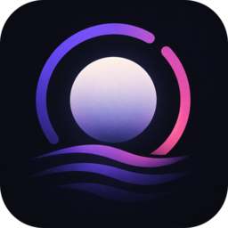
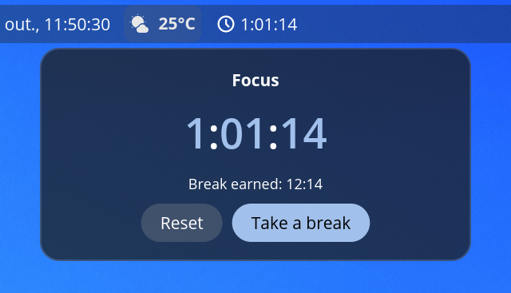
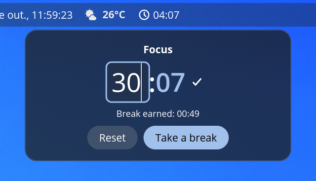
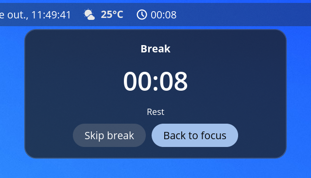

# Flowmodoro for COSMIC



A Flowmodoro timer applet for the
[COSMIC](https://system76.com/cosmic) desktop panel.

Unlike Pomodoro's fixed 25-minute blocks, Flowmodoro lets you focus for as long as you are in
flow. When you stop, you earn a break of **one fifth** of the time you focused
(50 min of focus → 10 min of break).

## Screenshots

| Focus | Fixing a timer you forgot to start | Break |
|------|-----------------------------------|-------|
|  |  |  |

## How it works

| Phase     | Panel shows              | Popup buttons                    |
|-----------|--------------------------|----------------------------------|
| Idle      | clock icon               | *Start focus*                    |
| Focus     | icon + elapsed time      | *Reset*, *Take a break*          |
| Break     | icon + remaining time, `+mm:ss` overrun once it ends | *End break*                      |

- **Click the panel button** to open the popup with the current phase, the clock and the break
  you have accrued so far.
- **Forgot to start the timer?** Click the minutes or seconds in the popup clock, type the
  correct value and press <kbd>Enter</kbd> or ✔. <kbd>Esc</kbd> cancels. Editing while idle
  starts a focus session with that much time already counted. Each part holds only what it
  can: 00–59 for minutes and seconds, 00–23 for hours, so nothing carries into the next part.
- **Still resting?** The break doesn't end by itself. Once it's over the panel counts up (`+mm:ss`)
  and the popup captions it `Late by: mm:ss`, so you can see how far over you are. The break only
  ends when you press *End break*.
- **Notifications** are sent when a break starts, when it ends, and once more if you're still on
  the break 5 minutes later.
- **Multiple monitors:** the COSMIC panel runs one applet process per monitor. They share their
  state through a small file in `$XDG_RUNTIME_DIR` (`$XDG_RUNTIME_DIR/app/<id>` under Flatpak),
  so every panel shows the same timer. The timer survives panel restarts and resets on logout.
- **Timer and Stats tabs:** the popup has a *Timer* tab (above) and a *Stats* tab: today's focus,
  sessions with their average and longest, breaks earned and taken, late breaks, the last seven
  days of focus, and how the sessions split into short (under 25 min), medium and long (50 min or
  more). Every finished focus and break is appended to `$XDG_DATA_HOME/flowmodoro/history`
  (`~/.local/share` by default), so the stats survive logout. The Stats tab reads the file each
  time the popup opens. A focus ended with *Reset* isn't kept.

The interface is in English, Brazilian Portuguese and Spanish, picked from the system language
(`LC_ALL`, `LC_MESSAGES` or `LANG`). To add a language, add a `Tr` table in `src/tr.rs` and a
branch in `pick()`, plus the `[xx]` / `xml:lang` entries in `data/`.

## Install

### From the COSMIC Store

Once published, search for **Flowmodoro** in the *Applets* section of the COSMIC Store, then add
it in **Settings → Desktop → Panel → Applets**.

### From source

Requirements: Rust ≥ 1.93 ([rustup](https://rustup.rs)), [`just`](https://github.com/casey/just)
and the libcosmic build dependencies:

```sh
# Pop!_OS / Ubuntu / Debian
sudo apt install cargo just pkg-config libxkbcommon-dev libfontconfig-dev libfreetype-dev libexpat1-dev cmake
# Fedora
sudo dnf install cargo just pkgconf libxkbcommon-devel fontconfig-devel freetype-devel expat-devel cmake
```

Then:

```sh
git clone https://github.com/JHPG/cosmic-ext-applet-flowmodoro.git
cd cosmic-ext-applet-flowmodoro
just install      # installs to ~/.local, no root needed
```

Add **Flowmodoro** in **Settings → Desktop → Panel → Applets**. If it doesn't show up, restart the
panel with `pkill -x cosmic-panel` (the session starts it again).

To remove it: `just uninstall`.

### As a local Flatpak

```sh
flatpak install --user flathub org.flatpak.Builder org.freedesktop.Sdk.Extension.rust-stable//25.08
just flatpak
```

## Development

```sh
just test         # unit tests
just build        # release build
just validate     # check the AppStream metainfo and desktop entry
just reload       # install + restart the panel, so the change is actually visible
```

One module per concern under [`src/`](src). [`main.rs`](src/main.rs) is the applet adapter and
the only file that mentions COSMIC; `phase.rs` is the phase machine, `reading.rs` what a phase
looks like, `state.rs` the shared state file and its bells, `history.rs` the history file,
`stats.rs` its numbers and `stats_view.rs` the Stats tab, `tab.rs` the tab bar, `tr.rs` the strings
and `clock.rs` the clock arithmetic. The break ratio is the `BREAK_RATIO` constant in `phase.rs`.

## License

[GPL-3.0-only](LICENSE)
